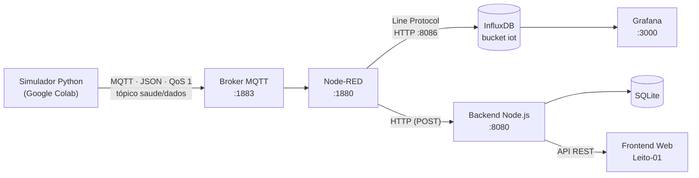

# 🏥 IoT Data Pipeline na AWS — Serviço de Saúde (Ranika)

Sistema de **monitoramento clínico em tempo real** que coleta, processa, armazena e exibe sinais vitais de pacientes (**frequência cardíaca** e **temperatura corporal**), com classificação automática de anomalias e visualização em dashboards.

> Projeto acadêmico desenvolvido na **Fatec Sorocaba** — Tecnologia em Análise e Desenvolvimento de Sistemas, disciplina de Programação Multiplataforma.

## 📑 Sumário

1. [Objetivo](#-1-objetivo)
2. [Problema que resolve](#-2-problema-que-resolve)
3. [Escopo](#-3-escopo)
4. [Requisitos](#-4-requisitos)
5. [Tecnologias utilizadas](#-5-tecnologias-utilizadas)
6. [Arquitetura](#-6-arquitetura)
7. [Estrutura do repositório](#-7-estrutura-do-repositório)
8. [Pré-requisitos](#-8-pré-requisitos)
9. [Instalação, configuração e execução](#-9-instalação-configuração-e-execução)
10. [Variáveis de ambiente](#-10-variáveis-de-ambiente)
11. [Dados IoT (MQTT)](#-11-dados-iot-mqtt)
12. [Banco de dados](#-12-banco-de-dados)
13. [API do backend](#-13-api-do-backend)
14. [Testes e validação](#-14-testes-e-validação)
15. [Deploy na AWS](#-15-deploy-na-aws)
16. [Segurança](#-16-segurança)
17. [Dashboards](#-17-dashboards)
18. [Organização do grupo](#-18-organização-do-grupo)

---

## 🎯 1. Objetivo

Demonstrar, na prática, como uma arquitetura de dados IoT pode ser aplicada ao contexto da saúde, **alertando equipes médicas de forma instantânea** sobre anomalias como **taquicardia** e **picos febris**, usando uma infraestrutura escalável em nuvem.

## ❗ 2. Problema que resolve

O acompanhamento de sinais vitais feito de forma manual e esporádica faz com que alterações críticas sejam percebidas tarde. O projeto propõe:

* coleta **contínua** dos sinais vitais;
* **classificação automática** de cada leitura (normal, alerta ou crítico);
* **visualização imediata** para a equipe, tanto em painel técnico (Grafana) quanto em interface web simples, voltada ao leito do paciente.

## 🧭 3. Escopo

**Dentro do escopo**

* Simulação de um dispositivo que mede BPM e temperatura de um paciente (`LEITO-01`);
* Transmissão via MQTT, integração com Node-RED e armazenamento de séries temporais;
* API REST com regras de negócio e histórico processado;
* Interface web com indicadores, gráfico e tabela de histórico;
* Dashboards no Grafana com alertas visuais;
* Execução de todos os serviços em uma única instância AWS EC2, via Docker.

**Fora do escopo**

* Sensores físicos reais (os dados são simulados);
* Autenticação e perfis de usuário;
* Múltiplos hospitais/clínicas e alta disponibilidade;
* Notificações externas (e-mail, SMS, push);
* Uso clínico real — o projeto é estritamente educacional.

## ✅ 4. Requisitos

### Requisitos funcionais

| ID | Requisito |
| :--- | :--- |
| RF01 | O sistema deve receber leituras de BPM e temperatura via MQTT no tópico `saude/dados` |
| RF02 | O sistema deve identificar o paciente/leito de cada leitura (`paciente_id`) |
| RF03 | O sistema deve armazenar todas as leituras brutas em banco de séries temporais (InfluxDB) |
| RF04 | O backend deve classificar cada leitura em **Normal**, **Alerta** ou **Crítico** |
| RF05 | O backend deve persistir o histórico processado em SQLite |
| RF06 | O backend deve expor endpoints REST para consulta do histórico |
| RF07 | O frontend deve exibir os valores atuais, um gráfico de evolução e a tabela de histórico |
| RF08 | O frontend deve atualizar os dados periodicamente, sem recarregar a página |
| RF09 | O Grafana deve exibir histórico e valores em tempo real, com alerta visual para BPM > 100 ou temperatura > 37,5 °C |

### Requisitos não funcionais

| ID | Requisito |
| :--- | :--- |
| RNF01 | **Tempo real:** a leitura deve aparecer nas telas poucos segundos após o envio |
| RNF02 | **Confiabilidade de entrega:** mensagens MQTT com QoS 1 (entrega ao menos uma vez) |
| RNF03 | **Portabilidade:** todos os serviços executam em containers Docker |
| RNF04 | **Escalabilidade:** uso de banco de séries temporais e broker leve, adequados ao crescimento do volume de dados |
| RNF05 | **Manutenibilidade:** código separado por camadas (`backend`, `frontend`, `iot`, `nodered`) |
| RNF06 | **Segurança:** credenciais e tokens fora do código-fonte, em variáveis de ambiente |
| RNF07 | **Simplicidade operacional:** SQLite embutido, sem servidor de banco adicional para o histórico processado |

### Regras de negócio (classificação)

| Indicador | Normal | Alerta | Crítico |
| :--- | :---: | :---: | :---: |
| **BPM** | 60 – 100 bpm | 101 – 120 bpm | > 120 bpm |
| **Temperatura** | 35,5 – 37,5 °C | 37,6 – 38,5 °C | > 38,5 °C |

> Valores abaixo de 60 bpm ou de 35,5 °C não estão previstos na tabela de classificação atual.

## 🛠️ 5. Tecnologias utilizadas

O núcleo do pipeline segue a **Stack MING**:

* **M**QTT — protocolo leve de publicação/assinatura para IoT
* **I**nfluxDB — banco de séries temporais
* **N**ode-RED — motor de integração e roteamento
* **G**rafana — visualização e alertas

| Camada | Tecnologia | Função |
| :--- | :--- | :--- |
| IoT / Simulação | Python + `paho-mqtt` (Google Colab) | Gera e envia BPM e temperatura |
| Mensageria | MQTT Broker (Eclipse Mosquitto, porta 1883) | Recebe e distribui as mensagens |
| Integração | Node-RED | Parse do JSON, roteamento para InfluxDB e backend |
| Armazenamento bruto | InfluxDB 2.7 | Séries temporais dos dados IoT |
| Visualização técnica | Grafana | Dashboards e alertas em tempo real |
| Backend | Node.js | API REST, regras de negócio, SQLite |
| Banco de histórico | SQLite | Histórico processado das leituras |
| Frontend | HTML + CSS + JavaScript | Interface web para a equipe médica |
| Infraestrutura | AWS EC2 + Docker / Docker Compose | Hospedagem e isolamento dos serviços |

## 🏗️ 6. Arquitetura

O sistema é um fluxo contínuo: do dispositivo simulado até as telas de visualização.



### Fluxo do pipeline no Node-RED

| Nó | Função |
| :--- | :--- |
| **MQTT IN** | Assina o tópico `saude/dados` |
| **JSON** | Converte o payload (string) em objeto JavaScript |
| **Function — Pegar BPM** | Extrai o campo `bpm` |
| **Function — Pegar Leito** | Extrai `paciente_id` para identificar o leito |
| **Function — Pegar Temp** | Extrai o campo `temperatura` |
| **Function 1** | Formata os dados no *Line Protocol* do InfluxDB |
| **HTTP Request** | Envia ao InfluxDB (porta 8086, bucket `iot`, medição `leitura_saude`) |

### Serviços e portas (containers)

| Container | Imagem | Porta |
| :--- | :--- | :---: |
| `api_backend` | `clinicaranika_backend` (build local) | 8080 |
| `node_red` | `nodered/node-red` | 1880 |
| `mqtt_broker` | `eclipse-mosquitto` | 1883 |
| `influx_db` | `influxdb:2.7` | 8086 |
| `grafana_dashboard` | `grafana/grafana` | 3000 |

## 🗂️ 7. Estrutura do repositório

```
IotSaude/
├── backend/        # API Node.js, regras de negócio e SQLite
│   ├── Dockerfile
│   ├── package.json
│   └── server.js
├── frontend/       # Interface web (index.html) + Dockerfile
├── iot/            # Simulador Python (notebook para Google Colab)
├── nodered/        # Fluxo exportado (nodered-flow.json)
├── mosquitto/      # Configuração do broker MQTT
├── docs/           # Documentação e dashboard do Grafana exportado
├── docker-compose.yml
└── README.md
```

## 📋 8. Pré-requisitos

| Recurso | Observação |
| :--- | :--- |
| **Conta AWS** com uma instância **EC2** (Linux) | O projeto foi executado em uma `t3.micro` |
| **Docker** e **Docker Compose** | Para subir todos os serviços |
| **Git** | Para clonar o repositório |
| **Node.js** e **npm** | Apenas para rodar o backend fora do Docker |
| **Conta Google** | Para executar o simulador no Google Colab |
| **Security Group** com portas liberadas | 22 (SSH), 80/8080 (aplicação), 1880, 1883, 3000 e 8086 |

> 💡 Em ambiente de produção, evite expor `8086` e `1883` para toda a internet; restrinja por IP.

## 🚀 9. Instalação, configuração e execução

### 9.1 Clonar o repositório

```bash
git clone https://github.com/nicollylemos/IotSaude.git
cd IotSaude
```

### 9.2 Configurar as variáveis de ambiente

```bash
cp .env.example .env
# edite o arquivo .env com os seus valores (ver seção 10)
```

### 9.3 Subir os serviços com Docker

```bash
docker compose up -d --build
docker ps    # confirma que os 5 containers estão "Up"
```

Para acompanhar os logs do backend:

```bash
docker logs -f api_backend
```

Saída esperada:

```
API da Clínica rodando na porta 8080
Banco de Dados SQLite da Clínica criado com sucesso!
```

### 9.4 Importar o fluxo no Node-RED

1. Acesse `http://<IP_DA_EC2>:1880`;
2. No menu superior direito, selecione **Import → Clipboard**;
3. Cole o conteúdo de `nodered/nodered-flow.json`;
4. Clique em **Import** e depois em **Deploy**.

### 9.5 Configurar o Grafana

1. Acesse `http://<IP_DA_EC2>:3000`;
2. Em **Connections → Data sources**, adicione o **InfluxDB** (URL `http://influx_db:8086`, bucket `iot`, com o token da sua instalação);
3. Importe o dashboard a partir do arquivo disponível na pasta `docs/`.

### 9.6 Executar o simulador de dados

1. Abra o notebook da pasta `iot/` no **Google Colab**;
2. Ajuste `BROKER_MQTT` com o IP/DNS da sua instância EC2 (porta `1883`);
3. Execute as células. O script publica uma leitura a cada **5 segundos**.

A partir daí o fluxo completo está em operação: os dados aparecem em tempo real no **Grafana** e na **interface web**.

### 9.7 Backend sem Docker (opcional, para desenvolvimento)

```bash
cd backend
npm install
npm start        # ou: node server.js
```

## 🔐 10. Variáveis de ambiente

Crie um arquivo `.env` (nunca versionado) a partir de um `.env.example` como o abaixo. Os **nomes** podem variar conforme o `server.js` e o `docker-compose.yml`; ajuste-os ao que o código realmente lê.

```env
# Backend
PORT=8080
DATABASE_PATH=./hospital.sqlite

# Broker MQTT
MQTT_HOST=mqtt_broker
MQTT_PORT=1883
MQTT_USER=seu_usuario_aqui
MQTT_PASSWORD=sua_senha_aqui

# InfluxDB
INFLUX_URL=http://influx_db:8086
INFLUX_ORG=sua_organizacao_aqui
INFLUX_BUCKET=iot
INFLUX_TOKEN=seu_token_aqui
```

| Variável | Para que serve | Obrigatória |
| :--- | :--- | :---: |
| `PORT` | Porta em que a API escuta | Não (padrão 8080) |
| `DATABASE_PATH` | Caminho do arquivo SQLite | Não |
| `MQTT_HOST` / `MQTT_PORT` | Endereço do broker | Sim |
| `MQTT_USER` / `MQTT_PASSWORD` | Credenciais do broker, se houver autenticação | Depende |
| `INFLUX_URL` | Endereço do InfluxDB | Sim |
| `INFLUX_ORG` | Organização do InfluxDB | Sim |
| `INFLUX_BUCKET` | Bucket de destino (`iot`) | Sim |
| `INFLUX_TOKEN` | Token de acesso ao InfluxDB | Sim |

> ⚠️ Os valores acima são apenas exemplos. **Nunca** publique senhas, tokens ou o arquivo `.env` no GitHub.

## 📡 11. Dados IoT (MQTT)

* **Protocolo:** MQTT (publish/subscribe assíncrono)
* **Tópico:** `saude/dados`
* **QoS:** 1 (entrega ao menos uma vez)
* **Formato:** JSON
* **Frequência:** 1 mensagem a cada 5 segundos

**Exemplo de payload:**

```json
{
  "paciente_id": "LEITO-01",
  "bpm": 82,
  "temperatura": 36.7
}
```

| Campo | Tipo | Descrição |
| :--- | :--- | :--- |
| `paciente_id` | string | Identificador do paciente/leito |
| `bpm` | inteiro | Batimentos por minuto |
| `temperatura` | decimal | Temperatura corporal em °C |

**Comportamento do simulador:** gera BPM entre 60 e 100 (normal) com ~10% de chance de uma anomalia entre 110 e 140 (taquicardia), e temperatura entre 36,0 e 37,5 °C com ~20% de chance de febre entre 37,8 e 39,5 °C.

## 🗄️ 12. Banco de dados

O projeto usa **dois bancos**, com papéis diferentes:

| Banco | Papel | Conteúdo |
| :--- | :--- | :--- |
| **InfluxDB 2.7** | Dados brutos de séries temporais | Bucket `iot` (retenção: ilimitada), medição `leitura_saude`, com BPM, temperatura e o leito |
| **SQLite** | Histórico processado pela API | Arquivo `hospital.sqlite`, criado automaticamente na primeira execução |

Cada registro processado no SQLite contém, logicamente: **horário**, **paciente/leito**, **BPM**, **temperatura** e **classificação** (Normal, Alerta ou Crítico).

> 💡 O arquivo `hospital.sqlite` é gerado em tempo de execução. Recomenda-se adicioná-lo ao `.gitignore`.

## 🔌 13. API do backend

* **URL base:** `http://<IP_DA_EC2>:8080`
* **Formato:** JSON
* **Autenticação:** não implementada

### Recebimento de leituras (Node-RED → Backend)

O Node-RED envia cada leitura ao backend por requisição HTTP `POST`, com o corpo:

```json
{
  "paciente_id": "LEITO-01",
  "media_bpm": 75,
  "media_temp": 37.0
}
```

Resposta esperada: **`201 Created`**.

### Consulta de histórico (Backend → Frontend)

O frontend consome a API via `fetch`, com atualização periódica, para obter a leitura atual, o histórico recente e os dados do gráfico.

| Método | Rota | Descrição |
| :---: | :--- | :--- |
| `POST` | *rota de recebimento — ver `backend/server.js`* | Recebe e classifica uma leitura |
| `GET` | *rota de histórico — ver `backend/server.js`* | Retorna as leituras recentes com classificação |

> 📝 Preencha a coluna **Rota** com os caminhos definidos em `backend/server.js`, para que este README fique completo.

## 🧪 14. Testes e validação

O projeto ainda **não possui testes automatizados**. A validação é feita manualmente, em quatro passos:

| # | Verificação | Como validar | Resultado esperado |
| :-: | :--- | :--- | :--- |
| 1 | Containers ativos | `docker ps` | 5 containers com status `Up` |
| 2 | Backend e banco | `docker logs -f api_backend` | Mensagens de API rodando e SQLite criado |
| 3 | Pipeline de dados | Executar o simulador e observar o Node-RED (aba *debug*) | Leituras chegando e `Status: 201` no envio ao backend |
| 4 | Visualização | Abrir Grafana e frontend | Gráficos e tabela atualizando em tempo real |

**Teste das regras de negócio:** o simulador gera anomalias de propósito (BPM de 110 a 140 e febre acima de 37,8 °C). Confira se o frontend e o Grafana destacam esses valores como **Alerta** ou **Crítico**.

**Evolução sugerida:** testes unitários da função de classificação (por exemplo com Jest) e execução em uma pipeline de CI no GitHub Actions.

## ☁️ 15. Deploy na AWS

Todo o sistema roda em **uma única instância EC2**, com os serviços em containers Docker.

1. **Criar a instância EC2** (Linux) e associar um **Security Group** com as portas necessárias;
2. **Conectar via SSH** e instalar Docker e Docker Compose;
3. **Clonar o repositório** e criar o arquivo `.env`;
4. **Subir os serviços** com `docker compose up -d --build`;
5. **Importar o fluxo** do Node-RED e **configurar o Grafana** (seções 9.4 e 9.5);
6. **Executar o simulador** no Google Colab apontando para o IP da instância.

**Atualização de versão:**

```bash
git pull
docker compose up -d --build
```

> 💰 Lembre-se de **parar a instância** quando não estiver em uso, para evitar custos.

## 🛡️ 16. Segurança

Seguindo as boas práticas de documentação, **não devem ser publicados** neste repositório:

* senhas e credenciais (banco, broker, administradores);
* tokens do InfluxDB e chaves de API;
* arquivos `.env` e configurações com segredos;
* IPs públicos, IDs de instância e detalhes de infraestrutura que facilitem acessos indevidos;
* dados pessoais de pacientes reais.

Recomendações:

* manter `.env` e `*.sqlite` no `.gitignore`;
* usar `<IP_DA_EC2>` e valores de exemplo nos arquivos de documentação;
* restringir as portas do Security Group aos IPs necessários;
* considerar autenticação no broker MQTT e HTTPS na API para uso além do contexto acadêmico.

## 📊 17. Dashboards

**Grafana** (porta 3000)

* gráfico de linha com o histórico de BPM e temperatura;
* métricas em tempo real com atualização automática;
* alerta visual quando **BPM > 100** (taquicardia) ou **temperatura > 37,5 °C**.

**Interface web — Monitoramento Leito-01**

* cards com frequência cardíaca (BPM) e temperatura corporal (°C);
* gráfico de linha com o histórico de BPM;
* tabela com horário, batimentos e temperatura das leituras recentes;
* indicador de status **"Sistema online"**.

## 👥 18. Organização do grupo

| Papel | Responsabilidades | Integrantes |
| :--- | :--- | :--- |
| IoT / Dados | Simulador Python (Colab), MQTT, Node-RED, InfluxDB | Karina de Moraes Garcia |
| Backend | API Node.js, regras de negócio, SQLite, endpoints REST | Nicolly Lemos da Silva e Karina de Moraes Garcia |
| Frontend | Interface web, gráficos, integração com a API REST | Rafaela Mansano Fernandes e Nicolly Lemos da Silva |
| Documentação | Documentação completa do projeto | Rafaela Mansano Fernandes |

---

*Projeto desenvolvido como requisito parcial para avaliação na disciplina de Programação Multiplataforma — Fatec Sorocaba, 2026.*
